<div align="center">



a tiny cozy room in your browser.<br>
two windows. one mood. zero dependencies.


</div>


## 🌧️ &nbsp;Pick a room

<table>
<tr>
<td width="50%" valign="top">

### Rain
*night · fog · lofi*

wipe the fogged glass and watch the city blur past.
a shy cat. a warm lamp. thunder somewhere far away.

</td>
<td width="50%" valign="top">

### Spring
*day · ocean · petals*

open window, shimmering curtain, real rolling waves.
a fluffy puppy who really wants a treat.

</td>
</tr>
</table>


## ✨ &nbsp;What's inside

**🌧️ Rain room**

- 🪟 foggy glass you can wipe, drops that refract the city
- ⛈️ four weathers: `rain` `storm` `clear` `cold`
- ⚡ lightning bolts + thunder + a cat who jumps
- 🐈 a wary cat. stroke it slowly to earn its trust
- 🎧 rain that muffles when your cursor leaves the window

**🌊 Spring room**

- 🌊 animated ocean: swells, breaking waves, foam, sun glitter
- ⛵ a sailboat, gulls, drifting petals
- 🌿 vines + blossoms swaying on an open white casement
- 🐶 **Biscuit**: fur drawn stroke by stroke, eyes that follow your cursor
- 🌷 tulip glass lamp, string lights, candles

**🛋️ Both rooms**

- ⏰ everything follows your **real time**: sun, moon, stars, lamps
- 📱 a tilted phone + a digital clock with your actual time
- 📝 iPad **to-do list** you can add to and tick off (it remembers)
- ☕ brew coffee · 🪴 water the plant until it blooms
- 📓 journal: write a thought, watch it evaporate off the glass
- 📻 radio: search any song, it plays quietly under the rain


## 🐶 &nbsp;Training Biscuit

tap him → pick a trick.

| trick | what he does |
|:--|:--|
| 🐾 **Paw** | shakes hands |
| 🌀 **Spin** | does a little twirl |
| 🔊 **Speak** | yip yip yip |
| 🛏️ **Down** | flops low |

he learns fast. two wins and it's **★ learned**.


## 🕹️ &nbsp;Poke around

| do this | get that |
|:--|:--|
| move over the glass | wipes the fog *(Rain)* |
| stroke the cat | trust grows, then purrs |
| click the lamp | warm light on/off |
| click the radio | search a song |
| click the iPad | open your to-do list |
| click the kettle / coffee / can | whistle · brew · water |
| `time` slider | scrub through the day |
| `switch theme` | hop between rooms |


## 🚀 &nbsp;Run it

no install. no build.

```bash
git clone https://github.com/YOUR-USERNAME/petrichor.git
cd petrichor
# open index.html in your browser
```

or use **Live Server** in VS Code. click *Step inside* to start the sound.

**deploy:** GitHub → Settings → Pages → `main` / root → live link in a minute.


## 🧪 &nbsp;Under the hood

```text
canvas 2D     fog, raindrops, ocean, waves, glitter, vines
Web Audio     rain, thunder, wind, birds, crickets, lofi, purr, yips
procedural    puppy fur, knit sweater, city skyline, sky
localStorage  cat trust, plant growth, puppy tricks, to-do list
```

one `index.html`. that's the whole project.


## 🌱 &nbsp;Next up

- [ ] real-weather sync
- [ ] mood tuner
- [ ] tea-cup focus timer
- [ ] more rooms *(train · rooftop · café)*
- [ ] shareable room links

<br>

<div align="center">

*made with rain, tea and too much lofi* ☔

**if it made you feel something, leave a ⭐**

</div>
